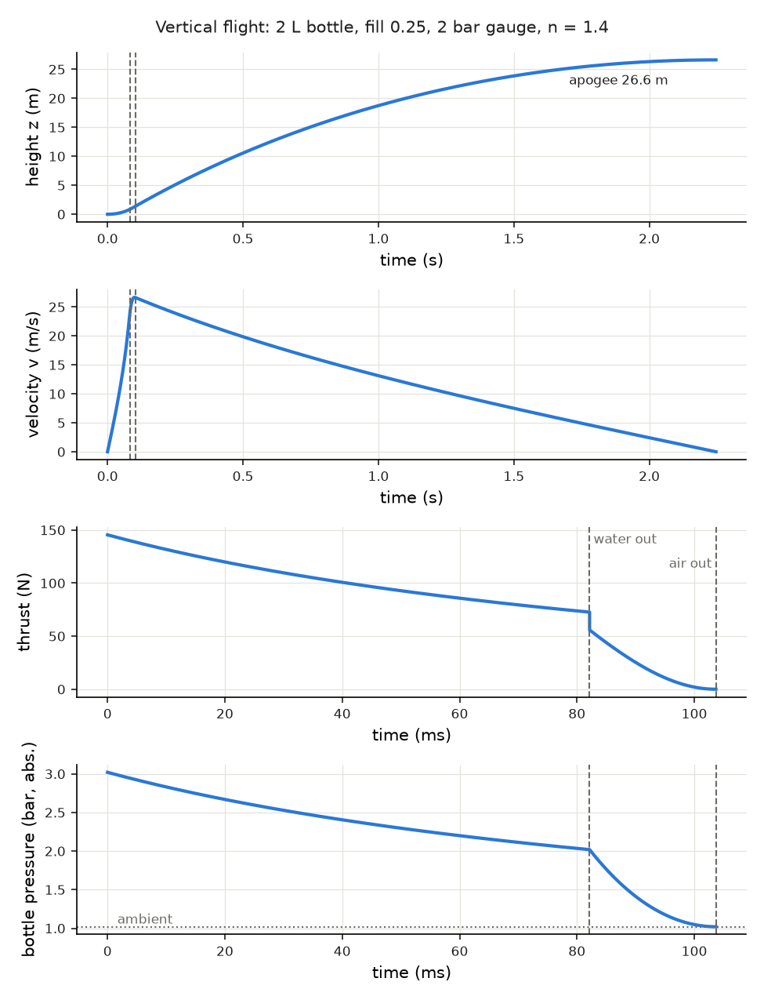
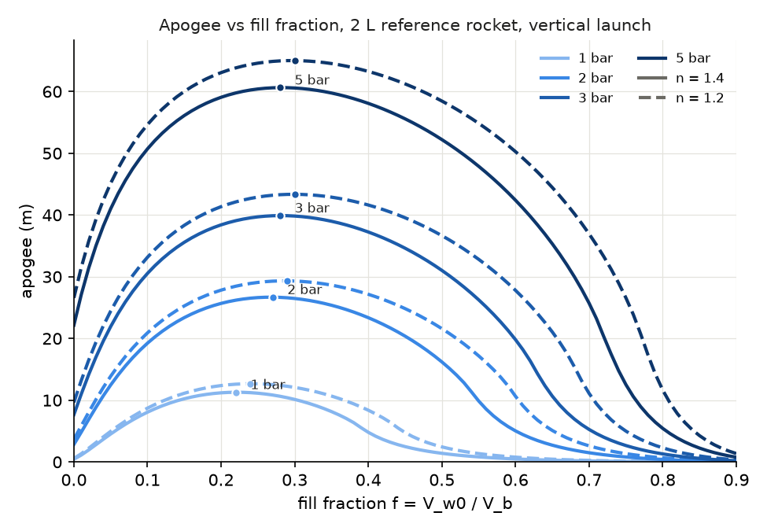

# Physics of a water rocket

A PET bottle, partly filled with water and pressurised with air, is
launched vertically, nozzle down. This document derives a model of its
flight in three phases, states the assumptions, and reports the apogee
as a function of the water fill. The model is implemented in
`code/rocket.py`; the figures are produced by `code/fig_trajectory.py`
and `code/fig_apogee_vs_fill.py`.

Labels used throughout:

- **Established**: textbook physics or a result stated and supported in
  a cited source.
- **Contested**: a point on which sources disagree or which a source
  shows to be questionable.
- **Own inference**: a result of this model or a reasoning step not
  stated in any cited source.

## 1. Rocket, ambient and notation

The parameters are those of the rocket of Barrio-Perotti et al. (2010),
section 5, measured by the authors. The drag coefficient was measured on
the same rocket by free fall (Barrio-Perotti et al. 2009).

| Symbol | Meaning | Value | Source |
|---|---|---|---|
| $V_b$ | bottle volume | 2 L | Barrio-Perotti 2010 |
| $m_b$ | empty rocket mass | 133.2 g | Barrio-Perotti 2010 |
| $D$ | bottle diameter | 106.0 mm | Barrio-Perotti 2010 |
| $d$ | nozzle diameter | 21.5 mm | Barrio-Perotti 2010 |
| $C_D$ | drag coefficient, area $A_b = \pi D^2/4$ | 0.345 | Barrio-Perotti 2009 |
| $p_a$ | ambient pressure | 1020 mbar | Barrio-Perotti 2010 |
| $T_a$ | ambient temperature | 22 °C | Barrio-Perotti 2010 |

Constants (textbook): $g = 9.80665$ m s$^{-2}$; dry air
$R = 287.05$ J kg$^{-1}$ K$^{-1}$, $\gamma = 1.4$; water density
$\rho_w = 997.8$ kg m$^{-3}$ at 22 °C. Ambient air density from the ideal
gas law: $\rho_a = p_a/(R T_a) = 1.204$ kg m$^{-3}$.

Derived: $A_n = \pi d^2/4 = 3.63\times10^{-4}$ m$^2$,
$A_b = 8.82\times10^{-3}$ m$^2$, $A_n/A_b = 0.041$.

Inputs of a flight: fill fraction $f = V_{w0}/V_b$, gauge pressure
$p_g$, polytropic exponent $n$. Pressures in the equations are absolute:
$p_0 = p_a + p_g$. Initial air volume $V_0 = (1-f)V_b$. The air is
assumed at ambient temperature at launch, so its mass is
$m_{air} = p_0 V_0/(R T_a)$.

The flight is one-dimensional: height $z$, velocity $v$, positive
upwards. Drag acts in all phases:

$$F_D = \tfrac12 \rho_a C_D A_b\, v|v| \tag{D1}$$

(established; Barrio-Perotti 2009, eq. 1).

## 2. Water phase

### 2.1 Air expansion

The air expands while it pushes the water out. Heat diffusion in the
gas during an ejection time $\tau \approx 0.1$ s reaches a depth
$\delta_h \approx \sqrt{\chi\tau} \approx 0.4$ mm, small compared with
the bottle radius (Gommes 2010, eq. 1). The expansion is therefore
modelled without heat exchange with the walls, as a polytropic process:

$$p = p_0\left(\frac{V_0}{V}\right)^{n} \tag{W1}$$

where $V$ is the air volume. For dry air $n = \gamma = 1.4$
(established). Moist air departs from this. Condensation of water vapour
during the expansion releases heat and lowers the effective exponent.
Gommes (2010, eq. 6) gives an empirical fit,
$\beta = 1.15 + 0.25\exp(-36\,P_V/P_i)$. Romanelli et al. (2013,
Table I) measured 1.17 to 1.22 in a stationary bottle; these values lie
0.05 to 0.06 below their own theoretical prediction in every row
(contested). Own inference: with the saturation pressure of water at
22 °C (2.64 kPa, textbook) and $p_0 = 3.02$ bar, the Gommes fit gives
$\beta = 1.33$. The baseline here is $n = 1.4$; $n = 1.2$ is run as a
sensitivity case (figure 2).

### 2.2 Exit velocity

Quasi-steady Bernoulli along a streamline from the water surface in the
bottle (velocity $u_e A_n/A_b$ by continuity) to the nozzle exit
(velocity $u_e$, pressure $p_a$), relative to the bottle:

$$u_e = \sqrt{\frac{2\,(p - p_a)}{\rho_w\left[1 - (A_n/A_b)^2\right]}} \tag{W2}$$

The driving term is the gauge pressure $p - p_a$. The area correction
changes $u_e$ by 0.1 % for this rocket. The same relation, with or
without the correction, is used by Fischer et al. (2020, eq. 7),
Urieli (2013, eq. 3) and Ding et al. (2025, eq. 10).

The air volume grows as the water leaves:

$$\frac{dV}{dt} = A_n u_e \tag{W3}$$

### 2.3 Momentum balance with variable mass

Rocket mass:

$$m = m_b + m_{air} + \rho_w (V_b - V) \tag{W4}$$

The water leaves the nozzle at velocity $u_e$ relative to the rocket,
at mass rate $\dot m = \rho_w A_n u_e$. With the jet at ambient pressure,
the thrust is the momentum flux of the jet:

$$F_T = \dot m\, u_e = \rho_w A_n u_e^2 \tag{W5}$$

Newton's law for a variable-mass body, with thrust, drag and weight:

$$m\frac{dv}{dt} = F_T - F_D - m g \tag{W6}$$

(established; Fischer 2020, eq. 10; Urieli 2013, eq. 10). Before lift-off
the pad holds the rocket: $dv/dt = 0$ while the right side of (W6) is
negative at $z = 0$.

The water phase ends when the water is exhausted, $V = V_b$, or when the
pressure has dropped to $p_a$ with water still in the bottle. From (W1),
the second case occurs when

$$f > f^{*} = 1 - \left(\frac{p_a}{p_0}\right)^{1/n} \tag{W7}$$

(own inference from W1). For $p_g = 2$ bar, $f^* = 0.54$ ($n = 1.4$) and
0.60 ($n = 1.2$). Above $f^*$ there is no air phase. The remaining water
is carried as dead mass to the apogee.

## 3. Air phase

When the water is exhausted, the bottle holds air at
$p_1 = p_0 (V_0/V_b)^n$ and temperature

$$T_1 = T_a \left(\frac{p_1}{p_0}\right)^{(n-1)/n} \tag{A0}$$

The bottle gas keeps expanding polytropically as it leaves through the
nozzle. With density $\rho = m_{air}/V_b$:

$$p = p_1\left(\frac{\rho}{\rho_1}\right)^{n} \tag{A1}$$
$$T = \frac{p}{\rho R} \tag{A2}$$

The flow through the convergent nozzle is treated as quasi-steady and
isentropic from the bottle state $(p, T)$, which is taken as the
stagnation state (established, textbook compressible flow; the same
approach as Barrio-Perotti 2010, section 4.2). The flow is choked while

$$\frac{p_a}{p} \le \left(\frac{2}{\gamma+1}\right)^{\gamma/(\gamma-1)} = 0.528 \tag{A3}$$

Choked: the exit is sonic and the exit pressure is above ambient,

$$p_e = 0.528\, p,\quad T_e = \frac{2T}{\gamma+1},\quad u_e = \sqrt{\gamma R T_e} \tag{A4}$$

Subsonic: the jet leaves at ambient pressure,

$$p_e = p_a,\quad T_e = T\left(\frac{p_a}{p}\right)^{(\gamma-1)/\gamma},\quad u_e = \sqrt{2 c_p (T - T_e)} \tag{A5}$$

with $c_p = \gamma R/(\gamma-1)$. In both cases

$$\dot m = \frac{p_e}{R T_e}\, u_e A_n \tag{A6}$$

The thrust includes a pressure term when the exit pressure differs from
ambient:

$$F_T = \dot m\, u_e + (p_e - p_a) A_n \tag{A7}$$

$$(m_b + m_{air})\frac{dv}{dt} = F_T - F_D - (m_b + m_{air}) g, \qquad \frac{dm_{air}}{dt} = -\dot m \tag{A8}$$

The air phase ends when $p = p_a$.

## 4. Ballistic phase

After burnout the mass is constant, $m_1 = m_b + m_{air}(p_a)$, plus
any water left (section 2.3):

$$m_1 \frac{dv}{dt} = -F_D - m_1 g \tag{B1}$$

The apogee is reached at $v = 0$. For upward motion (B1) has a closed
solution. The height gained from burnout velocity $v_1$ is

$$h_c = \frac{1}{2\psi}\ln\!\left(1 + \frac{\psi v_1^2}{g}\right), \qquad \psi = \frac{\rho_a C_D A_b}{2 m_1} \tag{B2}$$

(established; Fischer 2020, eq. 35). It is used as a check of the
numerical integration.

## 5. Numerical method

Each phase is integrated with `scipy.integrate.solve_ivp` (RK45,
relative tolerance $10^{-9}$ to $10^{-10}$, maximum step 1 ms in the
water phase, 0.1 ms in the air phase, 10 ms in the ballistic phase).
Phase ends are terminal events. The final state of one phase is the
initial state of the next.

Check: for $f = 0.25$, $p_g = 2$ bar, the integrated coast height and
(B2) both give 25.22 m.

## 6. Results

### 6.1 One flight

Figure 1: $f = 0.25$ (0.5 L of water), $p_g = 2$ bar, $n = 1.4$.

| Quantity | Value |
|---|---|
| peak thrust (at $t = 0$) | 145.5 N |
| initial acceleration | 22.3 $g$ |
| end of water phase | 82.2 ms, 23.9 m/s, 0.85 m |
| pressure at end of water phase | 2.02 bar (absolute) |
| end of air phase | 103.7 ms, 26.6 m/s, 1.41 m |
| apogee | 26.6 m at 2.25 s |

At the end of the water phase the thrust drops from 73 N to 56 N
(figure 1, third panel). The thrust changes from a water jet (W5) to a
choked air jet (A7) at the same bottle pressure.

Comparison with Barrio-Perotti 2010, figure 12, for the same rocket,
water volume and pressure, launched from a 45° ramp (own inference; the
launch conditions differ, so the comparison is of order of magnitude):

- Pressure during the water phase: 3 to 2 bar absolute in both.
- Velocity at the end of the water phase: 26.7 m/s there, 23.9 m/s
  here. At the end of the air phase: 30.7 m/s there, 26.6 m/s here.
- Gain in the air phase: about 15 % there, 11.5 % here.
- Initial acceleration: slightly above 70 $g$ there, 22 $g$ here. Their
  model keeps the inertia of the water in the bottle (their eqs. 5, 6,
  19, 20); the quasi-steady model (W2) does not. Kagan et al., as
  reported by Gommes (2010), measured about 100 $g$ on a 2 L bottle.
  Launch conditions of that measurement are not in the note
  (`sources/gommes2010more.md`). The difference is discussed in section 7.

### 6.2 Apogee versus fill fraction

Figure 2: $f$ from 0 to 0.9 in steps of 0.01; $p_g = 1, 2, 3, 5$ bar;
$n = 1.4$ (solid) and 1.2 (dashed). Dots mark the maximum of each curve.

Optimum fill (own inference, model result):

| $p_g$ (bar) | $n$ | $f_{opt}$ | water (L) | apogee (m) |
|---|---|---|---|---|
| 1 | 1.4 | 0.22 | 0.44 | 11.3 |
| 1 | 1.2 | 0.24 | 0.48 | 12.7 |
| 2 | 1.4 | 0.27 | 0.54 | 26.7 |
| 2 | 1.2 | 0.29 | 0.58 | 29.3 |
| 3 | 1.4 | 0.28 | 0.56 | 39.9 |
| 3 | 1.2 | 0.30 | 0.60 | 43.4 |
| 5 | 1.4 | 0.28 | 0.56 | 60.6 |
| 5 | 1.2 | 0.30 | 0.60 | 65.0 |

Observations (own inference):

- The optimum lies between 0.22 and 0.30 and moves up with pressure.
- The curves are flat near the optimum. At 2 bar, $f$ from 0.17 to 0.38
  gives apogees within 10 % of the maximum (own inference, same sweep).
- A lower exponent raises the apogee by 7 % to 12 % and the optimum by
  0.02. With $n = 1.2$ the pressure falls more slowly with volume, so
  the air does more work.
- The bend in each curve near $f^*$ (W7) marks the onset of
  overfilling: the pressure reaches $p_a$ before the water is gone.
- With no water ($f = 0$) the rocket still flies on air alone: 2.8 m at
  2 bar.

Comparison with the sources (trend only):

- Barrio-Perotti 2010 measured the maximum horizontal range at
  0.5 to 0.6 L of water for 2 bar gauge on a 45° ramp (their figure 10);
  their model gives an optimum of 0.5 to 0.6 L for 1 to 5 bar (figure
  14). The optimum for apogee here, 0.44 to 0.60 L, is in the same range.
  Range and apogee are different targets; the agreement is a check of
  trend, not a validation.
- Ding et al. 2025 report a simulated optimum water volume ratio of
  0.498 for a 2.13 L rocket at 0.75 MPa with a 1 cm nozzle. Their dry
  mass and drag coefficient are not stated (`sources/ding2025dynamics.md`),
  so the difference from 0.28 cannot be traced to a parameter. Both are
  model results.

## 7. Assumptions and limits

1. **Quasi-steady water flow (contested).** (W2) neglects the unsteady
   term and the inertial head of the water column. Gommes (2010,
   section II B) estimates both to be of the same order as the pressure
   term at the start of the thrust. Barrio-Perotti (2010) keep the
   inertia of the confined water and obtain an initial acceleration
   about three times that of this model (section 6.1). The effect on
   apogee is not quantified here. Open.
2. **Polytropic exponent.** $n$ is a parameter, not derived. The
   measured values come from a stationary bottle with an ejection time
   of 0.64 to 0.88 s (Romanelli 2013), not from a flying rocket.
3. **No heat exchange, air at ambient temperature at launch.** Heating
   by the pump is ignored.
4. **Nozzle.** Discharge coefficient 1, no losses, no launch tube.
5. **Transition from water to air.** The switch is instantaneous. A
   two-phase mixture leaves the nozzle at the transition in a real
   launch; it is not modelled.
6. **Air-phase nozzle flow** uses the isentropic relations with
   $\gamma = 1.4$ while the bottle gas follows exponent $n$. For
   $n = 1.4$ the two are consistent; for $n = 1.2$ they are not.
7. **Overfilled rocket.** Water left in the bottle when $p = p_a$ is
   carried to the apogee. Draining under gravity is ignored.
8. **One-dimensional vertical flight.** No wind, no rotation, no
   tilt. Buoyancy of the rocket is neglected.
9. **Constant drag coefficient.** $C_D = 0.345$ was measured for
   $10^3 < Re < 2\times10^5$ on the empty rocket falling nose down
   (Barrio-Perotti 2009). At 26.6 m/s, $Re \approx 1.9\times10^5$ (own
   inference, $\nu = 1.5\times10^{-5}$ m$^2$ s$^{-1}$): at the upper
   end of that range.
10. **Not validated.** The model is not compared with measured apogees
    or measured thrust curves. No source read in full gives thrust
    versus time for a flying rocket.

## References

- Barrio-Perotti R, Blanco-Marigorta E, Argüelles-Díaz K,
  Fernández-Oro J 2009. Experimental evaluation of the drag coefficient
  of water rockets by a simple free-fall test. Eur. J. Phys. 30,
  1039-1048. https://doi.org/10.1088/0143-0807/30/5/012
  (`sources/barrioperotti2009experimental.md`)
- Barrio-Perotti R, Blanco-Marigorta E, Fernández-Francos J, Galdo-Vega M
  2010. Theoretical and experimental analysis of the physics of water
  rockets. Eur. J. Phys. 31, 1131-1147.
  https://doi.org/10.1088/0143-0807/31/5/015
  (`sources/barrioperotti2010theoretical.md`)
- Ding S, Fan M, Liu L 2025. Dynamics model and simulation optimization
  analysis of single stage water rocket. Results Phys. 76, 108420.
  https://doi.org/10.1016/j.rinp.2025.108420
  (`sources/ding2025dynamics.md`)
- Fischer L et al. 2020. On the approximation of D.I.Y. water rocket
  dynamics including air drag. arXiv:2001.08828.
  https://doi.org/10.48550/arXiv.2001.08828
  (`sources/fischer2020approximation.md`)
- Gommes C J 2010. A more thorough analysis of water rockets: Moist
  adiabats, transient flows, and inertial forces in a soda bottle.
  Am. J. Phys. 78, 236-243. https://doi.org/10.1119/1.3257702
  (`sources/gommes2010more.md`)
- Romanelli A, Bove I, González Madina F 2013. Air expansion in a water
  rocket. Am. J. Phys. 81, 762-766. https://doi.org/10.1119/1.4811116
  (`sources/romanelli2013air.md`; read in the arXiv v1 version)
- Urieli I 2013. Water Rocket Analysis, lecture notes.
  https://people.ohio.edu/urieli/thermo/property_tables/gas/adiabatic/rocket/analysis2.html
  (`sources/urieli2013water.md`)
