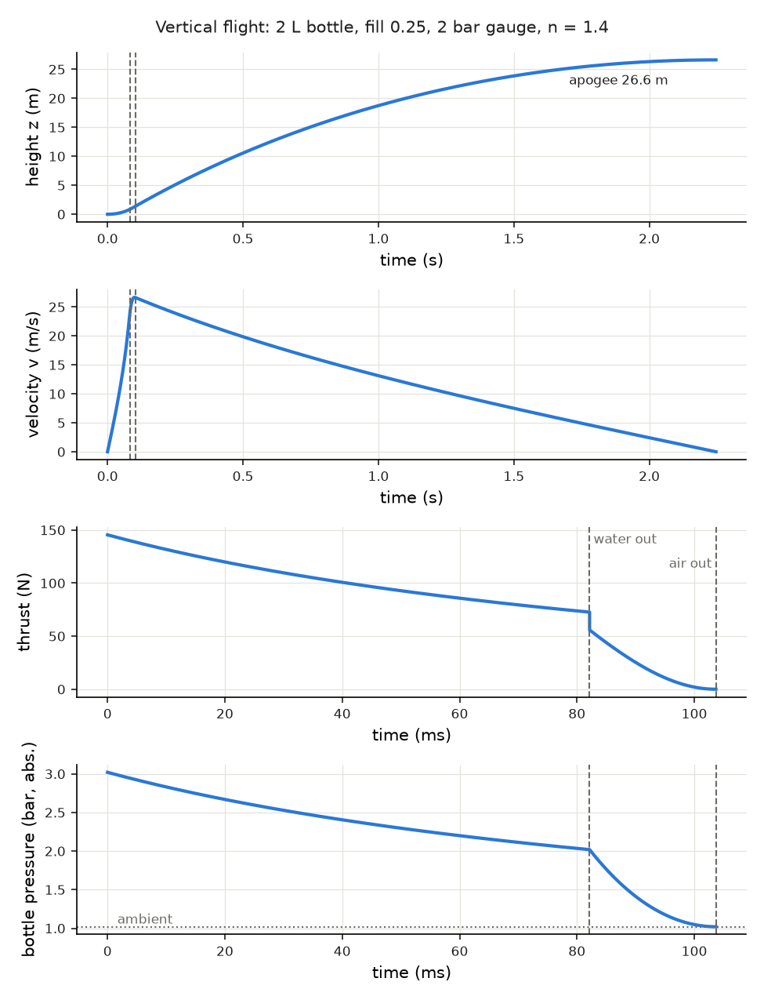

# live.md

New session, any harness: read `AGENTS.md`, then `journal/history.md`,
then continue from `Resume` below. Answer lines start with `R:`.

## Current task

Resume:
- Phase: 2 (physics, main session, no subagents). Repository
  `water-rocket-ai-workflow`, branch `main`. Last tag
  `phase-1-literature`.
- Done: Q1 to Q7 answered and archived. `code/rocket.py`,
  `code/fig_trajectory.py`, `code/fig_apogee_vs_fill.py`,
  `docs/physics.md`, `docs/figures/` (2 PNG) committed.
- Waiting for the user: Q1 (phase-2 review), Q2 (demo error).
- Next step after the answers: commit `journal: compact phase 2`, tag
  `phase-2-physics`, then phase 3 (run physics-referee). If Q2 asks for
  an error, it goes in first, in its own labelled commit.
- Talk: 2026-11-23. Phases 3 to 6 still to do.

## Open questions

**Q1. Phase 2 review.** Read `docs/physics.md` (results in section 6,
limits in section 7) and the two figures. Points to check: limit 1
(water inertia neglected: initial acceleration 22 $g$ here, about 70 $g$
in Barrio-Perotti 2010) and limit 6 (air phase with $\gamma$ in the
nozzle, $n$ in the bottle). Proposal: `R: ok` closes phase 2 as it is;
otherwise list corrections.
R: 

**Q2. Error for the live check.** BRIEF section 8: a physics error made
in phase 2 is left unfixed for the referee. I have not found one. One
error of mine was caught before the commit (a number read off a plot,
not physics; journal, `Method:` line). BRIEF: if there is none, you
introduce one in a separate commit `demo: introduce deliberate error for
the live check`. Proposal: you choose the error and write it here; I
make that commit and record it in `private/demo-error.md`. Example of a
plausible one: thrust in (W5) written as $\rho_w A_n u_e^2/2$, or the
absolute pressure $p$ in place of $p - p_a$ in (W2).
R: 

## Working notes

### Phase 2 results (from script output)

$f = 0.25$, $p_g = 2$ bar, $n = 1.4$: peak thrust 145.5 N; water out
at 82.2 ms, 23.9 m/s; air out at 103.7 ms, 26.6 m/s; apogee 26.6 m at
2.25 s. Coast height: numerical 25.22 m, eq. (B2) 25.22 m.

Optimum fill $f_{opt}$ (apogee, m): 1 bar 0.22 (11.3); 2 bar 0.27
(26.7); 3 bar 0.28 (39.9); 5 bar 0.28 (60.6), $n = 1.4$. With
$n = 1.2$: +0.02 in $f_{opt}$, +7 % to +12 % in apogee.
