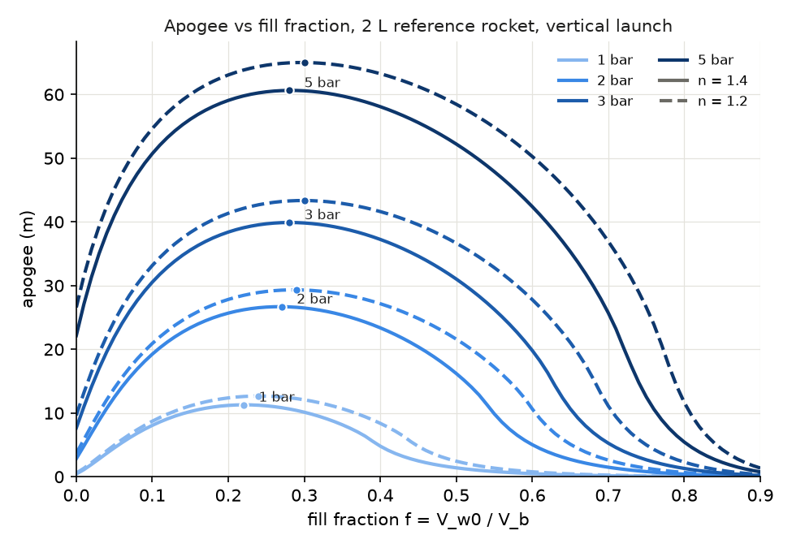

# live.md

New session, any harness: read `AGENTS.md`, then `journal/history.md`,
then continue from `Resume` below. Answer lines start with `R:`.

## Current task

Resume:
- Phase: 3 (physics check). Repository `water-rocket-ai-workflow`,
  branch `main`. Last tag `phase-2-physics` (on `journal: compact
  phase 2`).
- Done: phase 2 closed. Deliberate error in commit `db9a551` (details
  in git-ignored `private/demo-error.md`). Prompt to the referee in
  `prompts/phase-3.md`.
- In progress: `physics-referee` running; output
  `checks/physics-review.md`.
- Next step: read the report, check whether it found the deliberate
  error, summarise here, ask for the phase-3 review. If the session
  stopped before the report exists, rerun the agent with the prompt in
  `prompts/phase-3.md`.
- Talk: 2026-11-23. Phases 3 to 6 still to do.

## Open questions

None.

## Working notes

### Phase 2 results (from script output)

$f = 0.25$, $p_g = 2$ bar, $n = 1.4$: peak thrust 145.5 N; water out
at 82.2 ms, 23.9 m/s; air out at 103.7 ms, 26.6 m/s; apogee 26.6 m at
2.25 s. Coast height: numerical 25.22 m, eq. (B2) 25.22 m.

Optimum fill $f_{opt}$ (apogee, m): 1 bar 0.22 (11.3); 2 bar 0.27
(26.7); 3 bar 0.28 (39.9); 5 bar 0.28 (60.6), $n = 1.4$. With
$n = 1.2$: +0.02 in $f_{opt}$, +7 % to +12 % in apogee.
